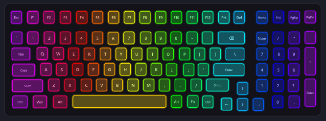
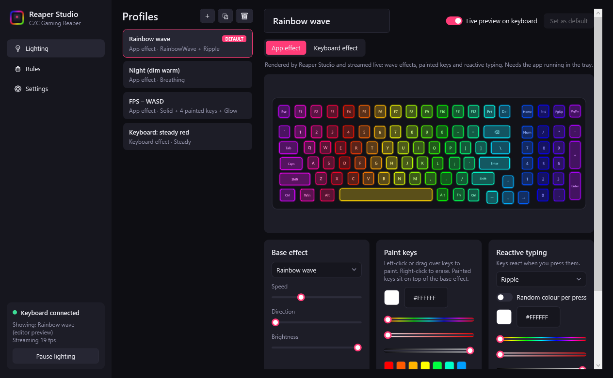
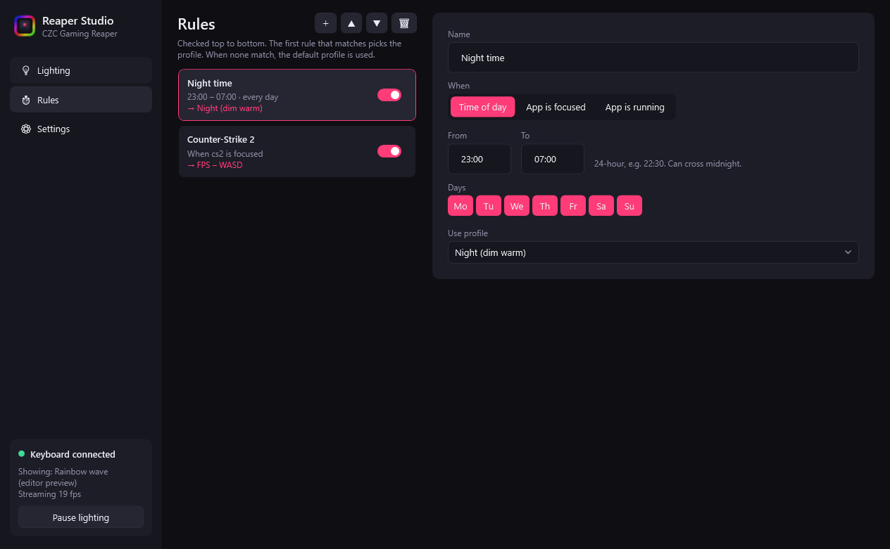
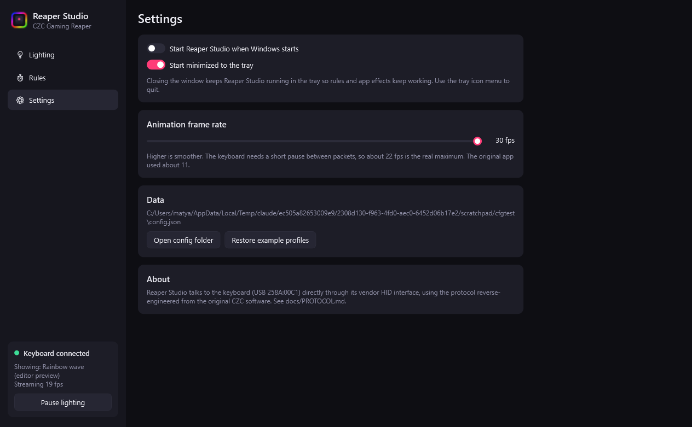

<p align="center">
  
</p>

<h1 align="center">Reaper Studio</h1>

<p align="center">
  <a href="https://github.com/MatyasMayer/ReaperStudio/actions/workflows/build.yml"></a>
</p>

<p align="center">
  A modern lighting studio for the <b>CZC Gaming Reaper</b> keyboard: per-key effects,
  reactive typing, and lighting that changes with the time of day or the game you're playing.
</p>

<p align="center">
  
</p>

---

The keyboard ships with a dated Windows tool that can only pick one effect at a time. Reaper Studio
replaces it. It talks to the keyboard directly over USB, using a protocol reverse-engineered from the
original software and documented in [`docs/PROTOCOL.md`](docs/PROTOCOL.md).

## Features

| | |
|---|---|
| 🌈 **App effects** | Rainbow wave, two-colour wave, breathing, colour cycle, starfield and solid colour, rendered on the PC and streamed to the keys at about 22 fps (twice the original app). |
| 🎨 **Per-key painting** | Click or drag on the on-screen keyboard to paint keys on top of any effect, e.g. red WASD over a dark background. |
| ⚡ **Reactive typing** | Pressed keys glow, or send out a ripple across the keyboard. |
| ⌨️ **Keyboard effects** | All 21 effects built into the firmware, with speed, brightness, colour and direction. They keep running even when the app is closed. |
| ⏱ **Rules** | Switch profiles automatically by time of day and weekday (windows can cross midnight), when a game is focused, or while an app is running. |
| 💾 **Save to keyboard** | Store a snapshot of a profile in the keyboard's own memory. |
| 🧩 **Stays out of the way** | Lives in the system tray, can start with Windows, and keeps everything in one JSON file. |

## Screenshots

### Lighting
Pick a profile, choose an app effect or a keyboard effect, paint keys and tune reactive typing.
With *Live preview* on, the keyboard shows your edits as you make them.



### Rules
Rule types have a fixed priority: **app focused → app running → time of day**. Within one type,
rules are checked top to bottom and the first match wins. When nothing matches, the default profile is used.



### Settings


## Other keyboards
Reaper Studio is only tested on the CZC Gaming Reaper. The Reaper is a rebadged
Royal Kludge RK98, so other Royal Kludge RGB boards (RK98, RK100, RK96, RK71, …)
likely speak the same protocol, but they are **not supported yet**: their key
layouts differ, and writing to an untested keyboard can brick it.
See [docs/research/compatible-keyboards.md](docs/research/compatible-keyboards.md)
for the evidence and what adding a model would take. If you own one of these
boards and want to help, open an issue with its USB VID:PID.

## Getting started

**Requirements:** Windows 10 (1803+) or 11 and a CZC Gaming Reaper (USB `258A:00C1`).

**Download:** grab `ReaperStudio-v*-win-x64.zip` from the
[latest release](https://github.com/MatyasMayer/ReaperStudio/releases/latest), unzip it and run
`ReaperStudio.exe`. It needs the [.NET 10 Desktop Runtime](https://dotnet.microsoft.com/download/dotnet/10.0).
Builds of every push to `main` are also available as artifacts of the
[Build workflow](https://github.com/MatyasMayer/ReaperStudio/actions/workflows/build.yml).

**Build from source** with the [.NET 10 SDK](https://dotnet.microsoft.com/download):

```powershell
git clone https://github.com/MatyasMayer/ReaperStudio.git
cd ReaperStudio
dotnet build ReaperStudio.sln -c Release
.\src\ReaperStudio\bin\Release\net10.0-windows\ReaperStudio.exe
```

> [!IMPORTANT]
> Close the original CZC app (`DeviceDriver.exe`) first. Both apps write to the same interface and
> would fight over the lighting. Reaper Studio shows a warning while the original is running.

Closing the window keeps Reaper Studio running in the tray, so rules and app effects keep working.
Use **Quit** in the tray menu to exit. Settings live in `%APPDATA%\ReaperStudio\config.json`.

## How it works

```
 ┌──────────────┐   rules: time / focused app / running app   ┌─────────────────┐
 │  Rule engine │ ──────────────────────────────────────────► │  active profile │
 └──────────────┘                                             └────────┬────────┘
                                   keyboard effect │                   │ app effect
                                                   ▼                   ▼
                                      02 29 (select firmware   render 126 LEDs → 06 00 frame
                                       effect once)             streamed ~22× per second
                                                   └────────┬───────────┘
                                                            ▼
                                  HID feature report 0x0A, 62-byte chunks, 2 ms apart
                                                            ▼
                                                 CZC Gaming Reaper (258A:00C1)
```

- **Keyboard effects** are selected once; the firmware animates them.
- **App effects** are rendered by `EffectRenderer` and streamed as real-time frames. If the stream
  stops, the keyboard falls back to its stored effect.
- The firmware needs a short pause between packets. Without it, a write occasionally hangs for 5 s.
  See the measurements in [`docs/PROTOCOL.md`](docs/PROTOCOL.md#transport-fun_0040fe80).

## Project layout

| Path | What |
|---|---|
| `src/ReaperStudio.Core` | HID transport, protocol messages, key layout, effect renderer, rule engine, config |
| `src/ReaperStudio` | WPF app: UI, tray icon, keyboard hook for reactive effects |
| `tests/ReaperStudio.Tests` | protocol bytes checked against captures of the original app, rule logic |
| `docs/PROTOCOL.md` | the reverse-engineered USB protocol |
| `tools/` | Python research tools: device probe, Frida HID sniffer, capture decoder, minimal driver, pacing benchmark |

```powershell
dotnet test   # run the test suite
```

### Diagnostics

| Environment variable | Effect |
|---|---|
| `REAPERSTUDIO_TRACE=C:\path\trace.log` | logs every keyboard write with timing; summarise with `python tools/trace_stats.py trace.log` |
| `REAPERSTUDIO_CONFIG_DIR=C:\some\dir` | uses a different config folder (handy for testing) |

## Privacy

The keyboard hook used for reactive typing only receives key-down codes in memory, to light the
matching key. Nothing you type is logged, stored or sent anywhere.

## Disclaimer

An independent project, not affiliated with or endorsed by CZC.cz or the keyboard's manufacturer.
It only changes lighting through the same commands the official software uses, and never touches
the keyboard's firmware. Use it at your own risk.
